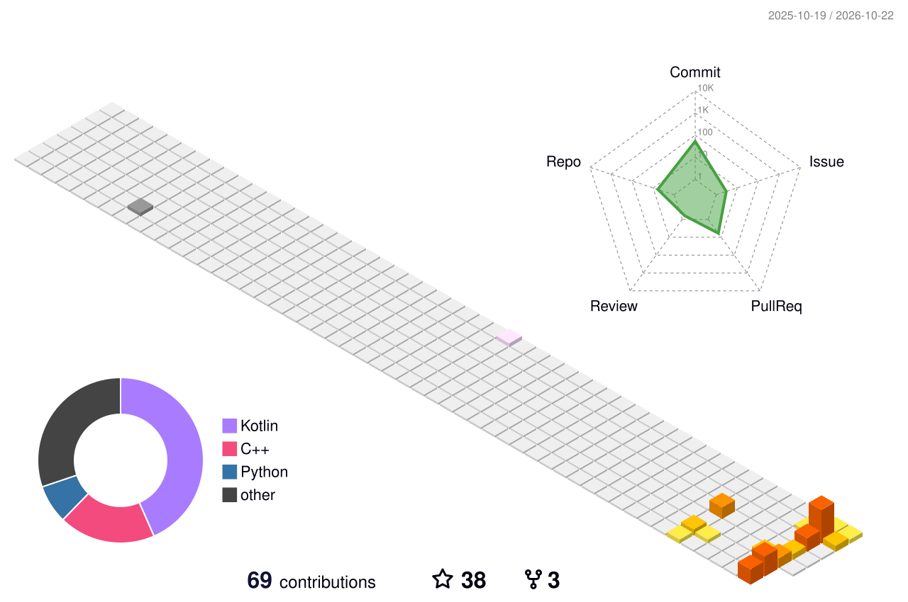

# zeroedx

  

## 访问次数

  Open Source · Technology · Exploration

  

## 统计数据

<table align="center">
  <tr>
    <td align="center">
      
    </td>
    <td align="center">
      
    </td>
  </tr>
</table>
